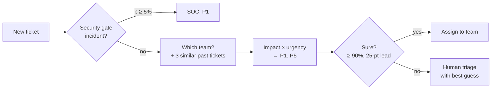

# triago  [](https://github.com/eduardd76/triago/actions/workflows/tests.yml)

**One forward pass. Right team — or it asks.**

triago reads an IT ticket and decides which team should handle it and how urgent it is, using a small
language model that runs **entirely on your own machine**. When it is sure, it assigns the ticket; when it
is not, it sends it to a human and says why. It plugs into GLPI out of the box, and into any other
ticketing system through a simple HTTP call.


- **Local and private.** The model (Qwen3-4B, Apache-2.0) runs on your laptop or server. Tickets never leave it.
- **Honest about confidence.** Every decision comes with calibrated probabilities. Below 90% it asks a human.
- **Security first.** Possible incidents skip normal routing and go straight to the SOC as P1.
- **Learns your team's habits** from the reassignments your technicians already make, with no training.
- **Fast.** About 1 second per ticket on a MacBook. The model never writes text, it only scores the allowed answers.

This is a *local Jev*: Jev-style fixed-answer scoring, rebuilt to run on your own hardware.

## Quick start

You need Python 3.11+ and, for the GLPI demo, Docker. First run downloads the model (~2.5 GB on a Mac).

**1. Try it in your browser (5 minutes)**

```bash
git clone https://github.com/eduardd76/triago && cd triago
python -m venv .venv && source .venv/bin/activate    # Windows: .venv\Scripts\activate
pip install -e ".[dev]"                              # Apple Silicon Mac
# pip install -e ".[torch,dev]"                      # Linux / Windows / Intel Mac instead
python -m triago.serve
```

Open **http://localhost:8642**, click an example ticket or paste your own.

**2. Full demo with a real helpdesk (GLPI) (10 minutes)**

```bash
cd itsm && docker compose up -d && cd ..     # GLPI 12 at http://localhost:8080, login glpi / glpi
scripts/setup_glpi.sh                        # one time: enables the API, installs the triago plugin
python -m triago.serve                       # terminal 1: the model (the GLPI plugin calls it)
python -m triago.dispatcher run              # terminal 2: safety net, routes anything the plugin missed
```

(In each new terminal: `cd triago && source .venv/bin/activate` first.)

Create a ticket in GLPI (**Assistance → Tickets → Add**). It opens already assigned to a team, with a
private note explaining the decision. Reassign a ticket to teach triago your rules, then run
`python -m triago.dispatcher feedback` (or schedule it nightly with `scripts/schedule_feedback_macos.sh`).

> The demo GLPI uses default passwords and an open API. Keep it on your machine.

## How it works



Each box is one question with a fixed list of answers (A, B, C...). The model reads the ticket once and
triago reads the score it gives each answer letter, instead of letting it write a reply. That makes every
decision fast, impossible to misparse, and comes with a probability you can set rules on.

**[How it works, in detail →](docs/how-it-works.md)** the scoring trick, calibration, the learning loop and the architecture.

## Connect your ticketing system

| your system | how | guide |
|---|---|---|
| **GLPI** | bundled plugin: tickets open already routed | [integration guide](docs/integration.md#glpi) |
| ServiceNow, Jira SM, Zammad, Freshservice, ... | your automation rule calls `POST /dispatch` and applies the answer | [HTTP API](docs/integration.md#http-api) |
| anything with an API but no webhooks | a small Python class with two methods; triago polls it | [connectors](docs/integration.md#python-connector) |

## Make it route like your team

1. **Your teams:** edit the team list in `triago/pipeline.py`.
2. **Your history:** add a few hundred resolved tickets as examples (+7 points on real tickets, no training).
3. **Your corrections:** reassignments in your helpdesk become examples every night.
4. **Optional fine-tune:** a 40-minute local training run on your Mac (+8 more points on real tickets).

**[Customization guide →](docs/customize.md)**

## Results

On sets never used for tuning (Qwen3-4B 4-bit on an Apple M5):

| test set | accuracy (which team) |
|---|---|
| 657 real IT tickets ([Zenodo](https://doi.org/10.5281/zenodo.7648117), 7 queues) | **80.8%**; **88.0%** after a local fine-tune (the dataset authors' trained model: 79%) |
| 300 realistic tickets, 8 languages, blind-reviewed | **85.0%** |
| 150 security stress tickets (40 incidents, 50 lookalikes) | **83.3%**; 32/40 incidents caught, 5 false alarms |

**Known weakness:** about 1 in 5 *subtle* incidents (MFA push fatigue, a lost laptop mentioned in passing)
is missed by the security gate, and password prompts sometimes trigger it. Use it to speed up your SOC,
not to replace your security alerting.

## Platforms

| machine | backend | model | speed |
|---|---|---|---|
| Apple Silicon Mac | MLX | `mlx-community/Qwen3-4B-Instruct-2507-4bit` (2.5 GB) | ~0.1–0.5 s per decision |
| Linux / Windows + NVIDIA GPU | PyTorch (CUDA) | `Qwen/Qwen3-4B-Instruct-2507` (8 GB, ~10 GB VRAM) | not measured yet |
| any CPU | PyTorch (CPU) | same | works; seconds per ticket |

CI runs the tests on macOS, Ubuntu and Windows. The backend is picked automatically; see
[configuration](docs/integration.md#configuration) to override it.

## Project layout

```
triago/            the Python package: scorer, pipeline, server + UI, GLPI client, fine-tuning
integrations/glpi/ GLPI plugin (PHP): routes tickets while they are created
itsm/              docker-compose for the demo GLPI
scripts/           GLPI setup, nightly feedback schedule, dataset download
docs/              how it works, integration, customization, labeling guide
data/              ~950 labeled demo tickets (fictional) for examples and benchmarks
tests/             unit tests (no model download needed)
```

## Contributing

Issues and pull requests are welcome; see [CONTRIBUTING.md](CONTRIBUTING.md). Good first contributions:
a connector for your helpdesk, a PyTorch fine-tuning script, or CUDA speed numbers.

## License and credits

Apache-2.0 (see [LICENSE](LICENSE)). The demo tickets in `data/` were written for this project with fictional
names and hosts, under the same license. The Zenodo benchmark dataset is not redistributed;
`scripts/fetch_zenodo.py` downloads it (CC BY 4.0, Benitez Pereira 2022, doi:10.5281/zenodo.7648117).
The fixed-answer scoring idea follows a published write-up of Jev-style restricted-softmax scoring
(SGLang `/v1/score`); this is an independent implementation. Model: Qwen3-4B-Instruct-2507 by the Qwen team (Apache-2.0).
