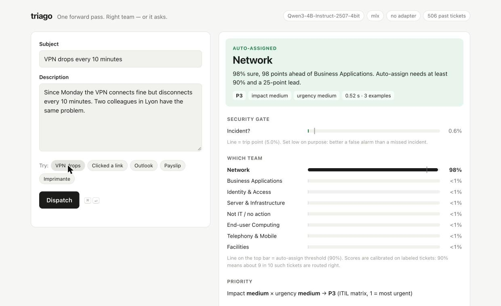

# triago  [](https://github.com/eduardd76/triago/actions/workflows/tests.yml)

**One forward pass. Right team — or it asks.**  Local, calibrated IT ticket dispatching for GLPI or any ticketing system.



Try it in 2 minutes: `pip install -e ".[dev]"`, then `python -m triago.serve` and open http://localhost:8642 (the first run downloads the ~2.5 GB model).

A local Jev: fixed-answer scoring on MLX (Apple Silicon) or PyTorch (Linux/Windows), wired to a GLPI demo ITSM.
No generated text and no training required (fine-tuning is optional): every decision is **one forward pass**, then a softmax over
the logits of the allowed label tokens (A, B, C, ...) only.

Each ticket goes through bounded decisions:

1. **Security gate** (security / normal) — calibrated; trips at p ≥ 0.05 → SOC, P1 (recall over false alarms)
2. **Assignment group** (8 groups + `other`), with the 3 most similar past tickets shown as worked examples
3. **Impact** and **urgency** (high/medium/low) → ITIL matrix in code → P1..P5
4. **Policy**: auto-assign if calibrated top ≥ 0.90 and margin ≥ 0.25, else `Service Desk Triage`

Every dispatch leaves a private followup in GLPI with the full probability breakdown.
Human reassignments are exported as labeled data and become new examples — the system learns
team conventions without training.

## Results (Qwen3-4B-Instruct-2507, 4-bit, Apple M5)

All numbers are on sets that were never used for tuning.

| test set | what it is | group accuracy | notes |
|---|---|---|---|
| Zenodo IT tickets, 657 test tickets | real MSP tickets, their own 7 queues | **80.8%**, macro-F1 **0.79**; **88.0%** with a local LoRA fine-tune | authors' trained model: 79% / 0.72 |
| `data/real_like`, 300 tickets | realistic, agent-written, blind-reviewed | **85.0%** | 3 sources: end users / IT & alerts / 8 languages |
| `data/fresh`, 150 tickets | security stress: 40 incidents + 50 lookalikes | **83.3%** | security gate: 32/40 incidents caught, 5 false alarms |

**Known weakness:** subtle incidents (MFA push fatigue, vendor bank-detail fraud, a lost laptop mentioned in passing) are
missed by the single-question security gate about 20% of the time on the stress set. Treat the gate as a filter that
speeds up the SOC, not as a replacement for SOC alerting.

Latency: ~0.8 s per ticket for all four decisions; the question+labels prefix is KV-cached.

## Install

Python ≥ 3.11. Docker only for the GLPI demo.

```bash
python -m venv .venv && source .venv/bin/activate     # Windows: .venv\Scripts\activate
pip install -e ".[dev]"            # Apple Silicon Mac: MLX backend
pip install -e ".[torch,dev]"      # Linux / Windows / Intel Mac: PyTorch backend (CUDA if present, else CPU)
python scripts/fetch_zenodo.py     # optional: real-world benchmark data (CC BY 4.0)
pytest                             # unit tests, no model download needed
```

| platform | backend | default model (downloads on first run) |
|---|---|---|
| Apple Silicon Mac | MLX | `mlx-community/Qwen3-4B-Instruct-2507-4bit` (~2.5 GB) |
| Linux / Windows + NVIDIA GPU | PyTorch, CUDA, bf16 | `Qwen/Qwen3-4B-Instruct-2507` (~8 GB, needs ~10 GB VRAM) |
| any CPU | PyTorch, CPU | same; works, but expect seconds per ticket |

Backend check on an M5 (40 Zenodo tickets, zero-shot): MLX 4-bit and PyTorch fp16 (MPS) pick the same
queue on 87.5% of tickets (different weight precision); 114 vs 271 ms per decision.

Override with `TRIAGO_BACKEND=mlx|torch` and `TRIAGO_MODEL=...` (any chat model whose answer letters
A, B, C... are single tokens; the scorer checks this and refuses otherwise). The calibration defaults
in `triago/pipeline.py` were fitted for the MLX 4-bit model; on another backend or model re-run
`python -m triago.bench` and use its temperatures.

## Run

```bash
python -m triago.serve                             # UI at http://localhost:8642 + POST /dispatch API
```


```bash
cd itsm && docker compose up -d          # GLPI at http://localhost:8080  (glpi / glpi) — demo only
source .venv/bin/activate
python -m triago.dispatcher run             # poll GLPI every 10s and dispatch New tickets
python -m triago.dispatcher feedback        # export human reassignments -> data/feedback.jsonl

python -m triago.bench                      # fit calibration on CALIB half, report on TEST half
python -m triago.bench --eval calib         # dev loop while editing descriptions
python -m triago.bench --holdout data/fresh # fit on CALIB, report on a never-tuned set
python -m triago.bench --shots 0            # without retrieved examples
python -m triago.bench --race               # scoring vs. text generation, same question
python -m triago.bench --seed               # push data/tickets.jsonl into GLPI as New tickets
python -m triago.zenodo_bench               # real-world check on the Zenodo dataset
```

API setup used for the demo (DB, local only): `enable_api=1`, `enable_api_login_credentials=1`,
API client "full access from localhost" with IP range cleared (Docker host is not 127.0.0.1).
Default credentials and an open API client: never expose this GLPI outside your machine.

## Integrate your ticketing system

GLPI is just the bundled example. Two ways to connect anything else:

**1. HTTP endpoint (no code): your system calls triago.** Best for ServiceNow, Jira Service Management,
Zammad, Freshservice, osTicket, or anything with webhooks/automation rules.

```bash
TRIAGO_API_KEY=change-me TRIAGO_HOST=0.0.0.0 python -m triago.serve     # default: 127.0.0.1:8642, no key
curl -s localhost:8642/dispatch -H "Authorization: Bearer change-me" \
     -d '{"subject": "VPN drops every 10 min", "body": "since Monday, whole Lyon office"}'
```

Response (shape; numbers illustrative):

```json
{"assign_to": "network", "group": "network", "auto": true, "priority": 2,
 "impact": "high", "urgency": "medium", "security_incident": false,
 "reason": "network=0.97, server_infra=0.01; security p=0.01", "probabilities": {...}, "latency_ms": 1100}
```

Your automation rule on "ticket created" POSTs subject + body, then sets the assignment group from
`assign_to` (map triago's keys to your group names; `triage` means *leave it for a human*) and the
priority from `priority` (1 = most urgent). `security_incident: true` is your hook to page the SOC.
It refuses to listen beyond localhost without `TRIAGO_API_KEY`; put it behind TLS if it crosses machines.

**2. Connector (a small Python class): triago polls your system.** Best when your ticketing system
can't call out, or you want triago to write notes back. Implement two methods
(contract in `triago/connector.py`):

```python
# mycompany/zammad.py
import os, requests
from triago.connector import Ticket

GROUPS = {"network": "Network", "end_user": "Workplace", "security": "SOC"}  # ... your names

class Zammad:
    def __init__(self):
        self.url, self.h = os.environ["ZAMMAD_URL"], {"Authorization": f"Token token={os.environ['ZAMMAD_TOKEN']}"}

    def pending(self):          # new tickets that have no group yet
        rows = requests.get(f"{self.url}/api/v1/tickets/search?query=state.name:new", headers=self.h).json()
        return [Ticket(t["id"], t["title"], t.get("body", "")) for t in rows]

    def apply(self, ticket, d, note):   # d.auto False -> your triage queue
        group = GROUPS.get(d.group, "Service Desk") if d.auto else "Service Desk"
        requests.put(f"{self.url}/api/v1/tickets/{ticket.id}", headers=self.h,
                     json={"group": group, "article": {"body": note, "internal": True}})
```

```bash
python -m triago.dispatcher run --connector mycompany.zammad:Zammad
```

(The Zammad snippet is a sketch of the shape, not a tested client — check your system's API docs.)

**Make it route like your team**, in this order:
1. Map your teams onto the 9 groups, or edit `GROUPS` in `triago/pipeline.py` to your own teams
   (one short keyword-style description each; at most 26, since the answer labels are the letters A–Z).
2. Add a few hundred of your own resolved tickets as examples: one `{"t": "<subject> | <body>", "g": "<group key>"}`
   per line in `data/gen/yours.jsonl`. This is the biggest win (+7 points on real tickets) and needs no training.
3. Re-fit calibration on your tickets (`python -m triago.bench`) before trusting `auto: true`.
4. Keep feeding corrections back: one `{"text": ..., "group": ...}` per line in `data/feedback.jsonl`
   (GLPI users get this from `python -m triago.dispatcher feedback`).

## Fine-tune on your own tickets (optional, local)

Retrieved examples need no training and come first. Once you have a few hundred to a few thousand
resolved tickets with trusted groups, a LoRA adapter trained on your Mac is the next step:

```bash
python -m triago.finetune data/my_tickets.jsonl    # one {"t": "<subject> | <body>", "g": "<group key>"} per line
export TRIAGO_ADAPTER=adapters/my_tickets          # only if it prints ACCEPTED; rollback: unset it
```

It scrubs e-mails, URLs, IPs, phone numbers, MACs and secrets (not names), splits train/valid/test
by hash, trains on the exact prompt the scorer reads with the loss on the answer letter only,
re-fits calibration on valid, and accepts the adapter only if it beats the base model on valid and,
for your own tickets, does not miss more security incidents. Nothing leaves the machine; the
adapter has seen your tickets, so keep it as private as they are (`adapters/` is git-ignored).

Measured on Zenodo (`python -m triago.finetune --zenodo`: 868 train tickets, ~40 min on an M5,
657 test tickets; "unseen" = the 534 test tickets whose text never appears in training):

| setup | test | unseen test |
|---|---|---|
| base, zero-shot | 73.4% | 69.9% |
| base + 3 examples (default without adapter) | 79.9% | 77.3% |
| fine-tuned, zero-shot | 83.1% | 80.1% |
| **fine-tuned + 3 examples** | **88.0%** | **85.8%** |

Training runs on MLX (Apple Silicon). The PyTorch backend loads PEFT adapters, but a PyTorch
training script is not included yet.

## How to change routing

Edit the label descriptions in `triago/pipeline.py` (`SECURITY`, `GROUPS`), keeping
`docs/labeling-guide.md` in sync, then run `python -m triago.bench --eval calib`. Only judge a change on
a held-out set, once. Lessons from this repo: descriptions tuned on ~30 tickets per group overfit
quickly; plain keyword lists beat nuanced sentences for a 4B model; retrieved examples help on real
queues (+7 points) because they carry team conventions.

## Files

- `triago/scorer.py` — MLX scorer: restricted softmax over label tokens, in-context single-token check, prefix KV cache, optional examples
- `triago/pipeline.py` — taxonomy, priority matrix, `Policy`, `route()` (pure, re-evaluable offline), `is_confident()`
- `triago/examples.py` — `ExampleStore`: char n-gram TF-IDF retrieval of similar labeled tickets
- `triago/backends.py` — where the forward pass runs: MLX (Apple Silicon) or PyTorch (CUDA/MPS/CPU)
- `triago/finetune.py` — local LoRA fine-tuning with PII scrubbing, answer-only loss and an accept/reject gate
- `triago/connector.py` — the two-method interface any ticketing system implements
- `triago/serve.py` — HTTP endpoint (`POST /dispatch`) for webhook-style integration, and the UI at `/`
- `triago/static/index.html` — the one-page UI (no build step, no external resources)
- `triago/glpi.py` — GLPI REST client and connector (groups, Group_Ticket, ITILFollowup)
- `triago/dispatcher.py` — poll loop + feedback export
- `triago/bench.py` — benchmark, temperature + security-threshold fitting, calibration tables, holdout mode
- `triago/zenodo_bench.py` — real-dataset benchmark against the authors' trained baseline
- `docs/labeling-guide.md` — taxonomy and settled boundary rules used for all labels
- `data/tickets.jsonl`, `data/gen/` — 506 synthetic dev tickets (CALIB/TEST split by hash)
- `data/real_like/`, `data/fresh/` — held-out realistic sets
- `data/external/zenodo_it_tickets/` — Benitez Pereira (2022), *Classification of IT Support Tickets*, Zenodo, doi:10.5281/zenodo.7648117, CC BY 4.0

## License and credits

Code: Apache-2.0 (see `LICENSE`). Ticket sets in `data/` were written for this project with fictional
names and hosts and are released under the same license. The Zenodo dataset is not redistributed;
`scripts/fetch_zenodo.py` downloads it (CC BY 4.0, cite Benitez Pereira 2022).
The fixed-answer scoring idea follows a published write-up of Jev-style restricted-softmax scoring
over label logits (SGLang `/v1/score`); this is an independent implementation.
