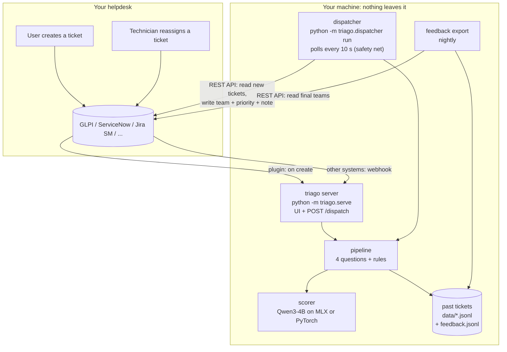
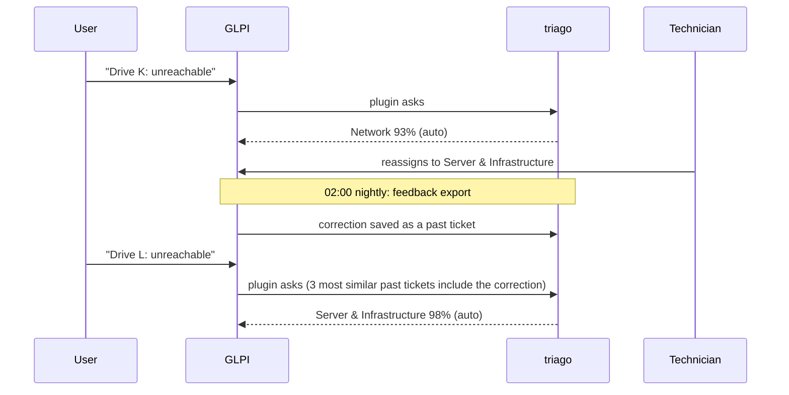

# How triago works

This page explains what happens to a ticket, why the model is used the way it is, and how the pieces fit
together. No machine-learning background needed.

## The big picture



| component | file | job |
|---|---|---|
| scorer | `triago/scorer.py`, `triago/backends.py` | runs the model; returns a probability for each allowed answer |
| pipeline | `triago/pipeline.py` | the four questions, their answer lists, and the rules that combine them |
| examples | `triago/examples.py` | finds the 3 most similar past tickets to show the model |
| server + UI | `triago/serve.py`, `triago/static/index.html` | `POST /dispatch` for any system; the web page at `/` |
| GLPI plugin | `integrations/glpi/triago/` | asks the server while GLPI saves a new ticket |
| dispatcher | `triago/dispatcher.py`, `triago/glpi.py` | polls GLPI for unrouted tickets; exports corrections |
| fine-tuning | `triago/finetune.py` | optional: trains a small adapter on your tickets |

The server and the dispatcher are two doors into the same pipeline. The GLPI plugin uses the server, so
tickets are routed before anyone opens them; the dispatcher catches whatever the plugin missed (server
down, ticket created through another channel).

## What happens to one ticket

Four questions, each with a fixed list of answers:

| # | question | answers | used for |
|---|---|---|---|
| 1 | Is this a security incident? | security / normal | if p ≥ 5%: straight to the SOC as P1, stop here |
| 2 | Which support group should handle it? | 8 teams + "not IT" | the assignment |
| 3 | What is the business impact? | high / medium / low | priority |
| 4 | How urgent is it? | high / medium / low | priority |

Then plain code, not the model, decides:

- **Priority** comes from the ITIL table: impact × urgency → P1 (critical) … P5.
- **Auto-assign or ask a human:** assign only if the top team has at least **90%** and leads the
  runner-up by **25 points**. Otherwise the ticket goes to *Service Desk Triage* with triago's best guess.
- **"Not IT"** (HR, payroll, auto-replies) is never auto-assigned. A person forwards or closes it.

The security question runs first because it is the expensive mistake. Its threshold is set low (5%) on
purpose: a false alarm costs the SOC a minute; a missed incident costs much more.

## The trick: score the answers, don't generate them

A chatbot answers by *writing* text, which you then have to parse ("I think this is a network issue
because…"). triago never lets the model write. It shows the question with lettered answers:

```
Question: Which support group should handle this ticket?
Allowed labels:
A = Network: wifi/LAN/WAN for a site, VPN connectivity, firewall rules, ...
B = Server & Infrastructure: servers, VMs, storage, file shares, backup, ...
C = End-user Computing: one user's laptop, printers, monitors, ...
...
Similar past tickets and their correct label:
- VPN disconnects every 10 minutes ... -> A
Ticket: VPN drops every 10 minutes | Since Monday the VPN ...
Return only the label.
```

and runs the model **once** over this text. At the end, the model holds a score for every possible next
word. triago reads only the scores of the letters `A`, `B`, `C`, … and turns them into probabilities that
add up to 100%. That's the whole decision:

```
A Network                  98%
B Server & Infrastructure   1%
C End-user Computing        <1%
```

Why this matters:

- **Fast:** one pass, no text generated. About 0.1–0.5 s per question on a MacBook.
- **Always valid:** the answer can only be one of the letters. Nothing to parse, nothing to hallucinate.
- **A number you can set rules on:** "assign if ≥ 90%" only works because every decision has a probability.
- **Cheap to repeat:** the question and answer list are the same for every ticket, so that part of the work
  is computed once and reused (a *prefix cache*). Only the ticket text is new each time.

## Calibration: making 90% mean 90%

Raw model scores are overconfident: the model says 99% far more often than it is right 99% of the time.
triago corrects this with one number per question (a *temperature*), fitted on labeled tickets so that,
among tickets scored around 90%, about 9 in 10 are routed right. The note in GLPI shows both: the raw
scores, and the calibrated value that the rules use (`security gate p=0.98`).

`python -m triago.bench` re-fits these numbers. Do it when you change the model, the team list or the backend.

## The learning loop

triago learns your team's habits without training, by showing the model your past decisions:



For each new ticket, triago finds the 3 most similar past tickets (by shared character patterns, which also
works across typos and languages) and puts them in the prompt with their correct team. One correction is
enough to change how similar tickets are routed. This measurably helps: +7 points on real tickets. Because
nothing is trained, a correction takes effect on the next ticket and can be undone by fixing the ticket in
GLPI (the export rewrites the file each night from GLPI).

When you have hundreds of corrections, `python -m triago.finetune` can build them into the model itself:
a small *LoRA adapter* (30 MB) trained locally in about 40 minutes. On real tickets this went from 79.9% to
88.0%. See the [customization guide](customize.md#fine-tuning).

## Where it runs

The scorer only needs one thing from the hardware: "run the model over this text and give me the scores
for the next word". Two backends provide it:

- **MLX** on Apple Silicon Macs (default there): the 4-bit model, 2.5 GB, uses the Mac's GPU.
- **PyTorch** everywhere else: NVIDIA GPUs (CUDA), Apple GPUs (MPS) or plain CPU.

Everything above the scorer (questions, rules, calibration, examples, server, plugin) is the same on every
platform.

## Design choices, and what we tried

- **Fixed answers, not free text:** every output is valid and comes with a probability.
- **A small model (4B), run locally:** privacy, no per-ticket cost, ~1 s latency, runs on a laptop.
- **Rules in code, not in the prompt:** priority and the auto-assign threshold are plain code, easy to audit and change.
- **Plain keyword descriptions beat clever sentences** for a 4B model; descriptions tuned on ~30 tickets per
  team overfit quickly. A narrower "Identity & Access" description looked better on the tuning set and worse
  on held-out tickets, so it was reverted.
- **Every benchmark number is on tickets never used for tuning**, and each held-out set was used once.
